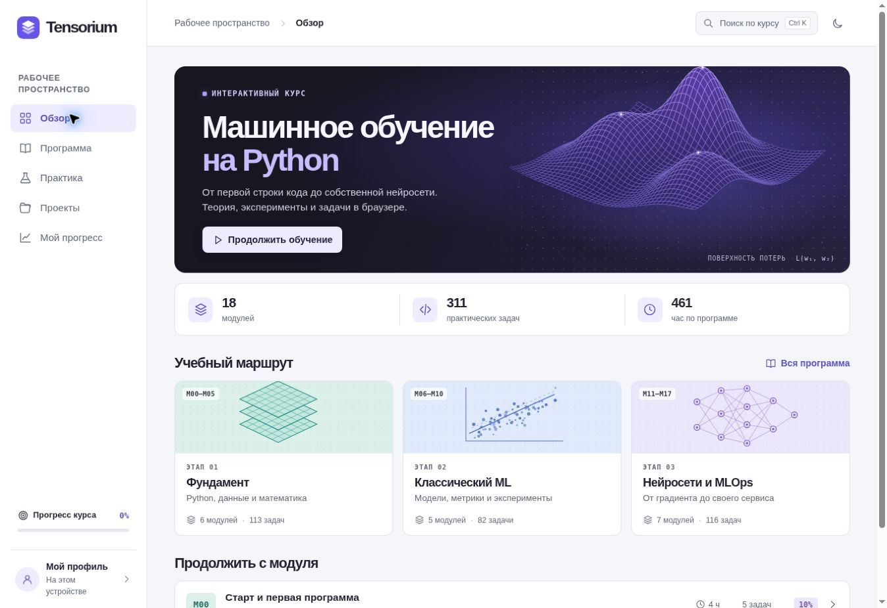

# Tensorium

Русскоязычная учебная платформа для самостоятельного изучения машинного обучения. Начните с первой строки Python, обучите нейросеть с нуля в NumPy, а затем перейдите к PyTorch, языковым моделям и выпускному проекту. На протяжении курса вы работаете с данными учебной службы доставки «Маршрут».



## Запуск

Из каталога с этим README выполните команду и откройте http://localhost:8000 в браузере.

```sh
python3 -m http.server 8000 --bind 127.0.0.1 --directory dist
```

Сборка и установка зависимостей для сайта не требуются. Весь каталог `dist/` можно разместить на статическом HTTP-хостинге. Пути относительные, поэтому сайт также работает в подкаталоге. Для выполнения Python нужен современный браузер с WebAssembly и Web Workers. Интерпретатор загружается при первом запуске кода.

## Учебный маршрут

| Этап | Модули | Содержание |
| --- | --- | --- |
| Фундамент | M00–M05 | Синтаксис и коллекции, инженерный Python и Git, NumPy, pandas, SQL, визуализация, линейная алгебра, градиентный спуск, вероятность и статистика |
| Классический ML | M06–M10 | Валидация и утечки, метрики, регрессия, классификация, деревья, ансамбли, кластеризация, временные ряды и рекомендации |
| Нейросети и MLOps | M11–M17 | Собственный обратный проход, XOR в NumPy, PyTorch, компьютерное зрение, NLP, трансформеры, LLM и RAG, API, мониторинг, выпускной проект |

В 18 модулях размещены 85 текстовых уроков, 188 задач с Python-автопроверкой и 123 практических вопроса с разбором. В конце каждого модуля есть квиз на пять вопросов. Для зачёта нужны четыре правильных ответа. 461 час — плановая трудоёмкость из ТЗ, включая самостоятельные эксперименты и проекты.

В разделе практики дополнительно доступны 8 рабочих миссий, 18 учебных инцидентов и свободная лаборатория. В четырёх выпускных треках есть бриф, критерии оценки, чек-лист и стартовый ZIP с Jupyter-блокнотом, учебными данными и исполняемой базовой моделью. Можно выбрать прогноз времени доставки, детектор задержек, контроль упаковки или поиск по инструкциям.

## Работа ученика

- Откройте первый урок из обзора. Переход «Прочитано, дальше» сохраняет результат. Поиск по названиям и содержанию открывается кнопкой в верхней панели или сочетанием Ctrl/Cmd + K.
- В редакторе «Запустить» выполняет код с введёнными данными, «Проверить» запускает тесты задания. После зачёта открывается разбор решения. Черновик, история последних проверок и отметка о прохождении сохраняются на устройстве.
- В уроках с примерами можно скачать файл Python и блокнот модуля. NumPy и SQLite входят в поставку. Для pandas, SciPy и scikit-learn среда по запросу загружает совместимые пакеты с проверкой контрольной суммы. PyTorch и примеры с серверными библиотеками запускаются локально или в Jupyter с установленными зависимостями.
- В «Мой прогресс» доступны экспорт и импорт JSON. На странице проекта можно сохранить ссылку на коммит, отметить готовые артефакты и выгрузить отчёт в Markdown.

## Состав проекта

| Каталог | Назначение |
| --- | --- |
| `dist/content/` | Материалы M00–M17, эталонные решения, тесты, миссии, инциденты и проекты |
| `dist/js/` | Маршруты, интерфейс, состояние, проверка и перенос прогресса |
| `dist/runtime/` | Изолированный Python-исполнитель, автопроверка и файлы дистрибутива |
| `dist/kits/` | Четыре готовых набора учебных данных и блокнотов |
| `tools/` | Проверка курса и воспроизводимая генерация иллюстраций и наборов данных |
| `docs/` | Исходное техническое задание и изображение кабинета |

## Проверка

Проверка материалов использует стандартную библиотеку Python. Два теста среды требуют Node.js 22 или новее. Для запуска тестов интернет не нужен.

```sh
python3 tools/check_course.py
node dist/runtime/verify.mjs
node dist/runtime/verify-worker.mjs
```

Первый тест исполняет 205 эталонных программ, включая миссии и инциденты, проверяет 438 условий и отклонение пустых решений. Второй и третий загружают комплектный CPython в WebAssembly, проверяют ввод, вывод, обработку ошибок, NumPy, SQLite и обмен сообщениями с изолированным исполнителем. Наборы проектов можно пересоздать командой `python3 tools/project_kits.py`.

## Границы этой версии

Сайт работает без регистрации. Учётные записи учащихся, серверная синхронизация между устройствами, платёжный провайдер, преподавательское ревью, коммерческая CMS и серверный GPU-раннер из полного ТЗ относятся к дальнейшей разработке. Для самопроверки тесты и разборы поставляются клиенту вместе с учебным материалом. Официальная аттестация потребует отдельного серверного контура проверки.

Pyodide 0.27.7, CPython и колёса библиотек поставляются с исходными уведомлениями о лицензиях в `dist/runtime/vendor/` и внутри соответствующих архивов. Версии пакетов и их хеши зафиксированы в `pyodide-lock.json`. Учебные наборы созданы скриптом проекта и содержат синтетические данные.
